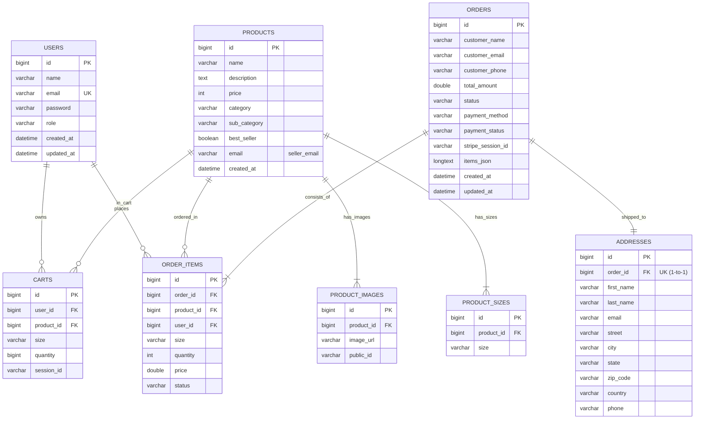

# 🛒 CloTheOnL — Full-Stack E-Commerce Platform

A production-ready, full-stack multi-vendor e-commerce web application engineered with **Spring Boot 3**, **React (Vite)**, **MySQL**, **Stripe Checkout**, and **Cloudinary CDN**.

---

## 📑 Table of Contents
- [Architecture & Tech Stack](#-architecture--tech-stack)
- [Entity-Relationship (ER) Diagram](#-entity-relationship-er-diagram)
- [Database Design & Schema](#-database-design--schema)
  - [High-Level Architecture](#high-level-architecture)
  - [Data Dictionary & Table Specifications](#data-dictionary--table-specifications)
  - [Key Relationships & Cascades](#key-relationships--cascades)
  - [Multi-Vendor & Seller Isolation](#multi-vendor--seller-isolation)
  - [Recommended Production Indexes](#recommended-production-indexes)
- [Project Directory Structure](#-project-directory-structure)
- [Core Features](#-core-features)
- [REST API Reference](#-rest-api-reference)
- [Getting Started & Local Setup](#-getting-started--local-setup)

---

## 🚀 Architecture & Tech Stack

```
┌─────────────────────────────────┐      ┌─────────────────────────────────┐
│     Customer Storefront         │      │          Admin Panel            │
│   (React + Vite + Tailwind)     │      │   (React + Vite + Tailwind)     │
│     http://localhost:5174       │      │     http://localhost:5173       │
└────────────────┬────────────────┘      └────────────────┬────────────────┘
                 │                                        │
                 └───────────────────┬────────────────────┘
                                     │ REST APIs / JWT
                                     ▼
                   ┌──────────────────────────────────┐
                   │    Spring Boot 3 REST Backend    │
                   │      (Java 21 + Spring Data JPA) │
                   │        http://localhost:8080     │
                   └───────┬──────────────────┬───────┘
                           │                  │
                ┌──────────┴────────┐   ┌─────┴────────────────┐
                │ MySQL Database    │   │ Third-Party Services │
                │ (Port 3307/3306)  │   │ • Stripe Payment     │
                │ Schema: e_commerce│   │ • Cloudinary CDN     │
                └───────────────────┘   └──────────────────────┘
```

- **Backend**: Java 21, Spring Boot 3.x, Spring Data JPA, Spring Security (Stateless JWT Authentication), Hibernate ORM, Maven.
- **Storefront (Customer)**: React 18, Vite, React Router v6, Tailwind CSS, Axios, React Toastify.
- **Admin & Seller Portal**: React 18, Vite, Tailwind CSS, Multi-vendor order and product management.
- **Database**: MySQL 8.x (`e_commerce`).
- **Payment Gateway**: Stripe Checkout Session API (`stripe-java`).
- **Media Storage**: Cloudinary CDN (multipart image uploads).

---

## 🗄️ Database Design & Schema

### High-Level Architecture
- **Engine**: MySQL 8.x
- **Schema**: `e_commerce`
- **ORM / Entity Mapping**: Jakarta Persistence (JPA) / Hibernate (`ddl-auto=update`)
- **Primary Keys**: `BIGINT` with `GenerationType.IDENTITY` auto-increment.
- **Multi-Vendor Architecture**: Products carry vendor emails (`products.email`), allowing order items to be filtered per seller while preserving atomic order placement.

---

## 📊 Entity-Relationship (ER) Diagram

### 1. Interactive Mermaid ER Diagram
The visual diagram below highlights the entities, primary keys (`PK`), foreign keys (`FK`), and cardinalities across the database schema:



### 2. Universal Schema Architecture (ASCII Diagram)
For environments where JavaScript or Mermaid rendering is disabled:

```
                               ┌──────────────────────────┐
                               │          USERS           │
                               ├──────────────────────────┤
                               │ PK  id                   │
                               │ UK  email                │
                               │     name, password, role │
                               └─────────┬──────┬─────────┘
                                         │ 1    │ 1
                         ┌───────────────┘      └────────────────┐
                         │ owns (1:N)                            │ places (1:N)
                         ▼                                       ▼
       ┌──────────────────────────┐            ┌──────────────────────────┐
       │          CARTS           │            │       ORDER_ITEMS        │
       ├──────────────────────────┤            ├──────────────────────────┤
       │ PK  id                   │            │ PK  id                   │
       │ FK  user_id              │            │ FK  order_id             │◄─────────┐
       │ FK  product_id           │◄─────┐     │ FK  product_id           │◄───┐     │
       │     size, quantity       │      │     │ FK  user_id              │    │     │
       └──────────────────────────┘      │     │     size, qty, price     │    │     │
                                         │     │     status               │    │     │
                                         │     └──────────────────────────┘    │     │
                                         │ in cart (1:N)         ordered (1:N) │     │
                                         │                                     │     │
                               ┌─────────┴───────────────┐                     │     │
                               │        PRODUCTS         │                     │     │
                               ├─────────────────────────┤                     │     │
                               │ PK  id                  │                     │     │
                               │     name, price, desc   │                     │     │
                               │     category, email     │                     │     │
                               └─────────┬───────┬───────┘                     │     │
                                         │ 1     │ 1                           │     │
                         ┌───────────────┘       └──────────────┐              │     │
                         ▼ has_images (1:N)                     ▼ has_sizes    │     │
       ┌──────────────────────────┐            ┌──────────────────────────┐    │     │
       │      PRODUCT_IMAGES      │            │      PRODUCT_SIZES       │    │     │
       ├──────────────────────────┤            ├──────────────────────────┤    │     │
       │ PK  id                   │            │ PK  id                   │    │     │
       │ FK  product_id           │            │ FK  product_id           │    │     │
       │     image_url, public_id │            │     size                 │    │     │
       └──────────────────────────┘            └──────────────────────────┘    │     │
                                                                               │     │
                                                                               │ N   │
                               ┌──────────────────────────┐                    │     │
                               │          ORDERS          │────────────────────┘     │
                               ├──────────────────────────┤ consists_of (1:N)        │
                               │ PK  id                   │                          │
                               │     customer_email/phone │                          │
                               │     total_amount, status │                          │
                               │     payment_method/stat  │                          │
                               │     stripe_session_id    │                          │
                               └─────────────┬────────────┘                          │
                                             │ 1                                     │
                                             │ shipped_to (1:1)                      │
                                             ▼ 1                                     │
                               ┌──────────────────────────┐                          │
                               │        ADDRESSES         │                          │
                               ├──────────────────────────┤                          │
                               │ PK  id                   │                          │
                               │ FK  order_id (UNIQUE)    │                          │
                               │     first/last name      │                          │
                               │     street, city, state  │                          │
                               │     zip_code, country    │                          │
                               └──────────────────────────┘                          │
```

### 3. Cardinality & Relationship Matrix

| Primary Entity | Relationship | Dependent Entity | Cardinality | Foreign Key (`FK`) | JPA Cascade & Lifecycle |
| :--- | :--- | :--- | :---: | :--- | :--- |
| `users` | Owns active cart items | `carts` | $1 : N$ | `carts.user_id` | `cascade = CascadeType.ALL, orphanRemoval = true` |
| `users` | Placed item history | `order_items` | $1 : N$ | `order_items.user_id` | `fetch = FetchType.LAZY` |
| `products` | Product image gallery | `product_images` | $1 : N$ | `product_images.product_id` | `cascade = CascadeType.ALL, orphanRemoval = true` |
| `products` | Apparel size variants | `product_sizes` | $1 : N$ | `product_sizes.product_id` | `cascade = CascadeType.ALL, orphanRemoval = true` |
| `products` | Added into cart | `carts` | $1 : N$ | `carts.product_id` | `fetch = FetchType.EAGER` |
| `products` | Purchased line item | `order_items` | $1 : N$ | `order_items.product_id` | `fetch = FetchType.EAGER` |
| `orders` | Delivery shipping address | `addresses` | $1 : 1$ | `addresses.order_id` (Unique) | `cascade = CascadeType.ALL, orphanRemoval = true` |
| `orders` | Purchased order items | `order_items` | $1 : N$ | `order_items.order_id` | `cascade = CascadeType.ALL, orphanRemoval = true` |

> [!NOTE]
> **Notation Legend**:
> - `||--||` : Exactly One to Exactly One ($1 : 1$)
> - `||--o{` : One to Zero or More ($1 : N$, optional)
> - `||--|{` : One to One or More ($1 : N$, mandatory)
> - `PK` : Primary Key
> - `FK` : Foreign Key
> - `UK` : Unique Key / Unique Constraint

---

### Data Dictionary & Table Specifications

#### 1. `users` Table
Stores user accounts, credentials, and role privileges.

| Column | Data Type | Constraints | Description |
| :--- | :--- | :--- | :--- |
| `id` | `BIGINT` | `PK`, `AUTO_INCREMENT` | Unique identifier for the user account |
| `name` | `VARCHAR(50)` | `NOT NULL` | Full name of the user |
| `email` | `VARCHAR(255)` | `NOT NULL`, `UNIQUE` | User login email address |
| `password` | `VARCHAR(255)` | `NOT NULL` | BCrypt encrypted password hash |
| `role` | `VARCHAR(50)` | `DEFAULT 'USER'` | Authorization role (`USER`, `ADMIN`, `SELLER`) |
| `created_at`| `DATETIME` | Nullable | User registration timestamp |
| `updated_at`| `DATETIME` | Nullable | Last profile update timestamp |

---

#### 2. `products` Table
Stores core product catalog items and seller association.

| Column | Data Type | Constraints | Description |
| :--- | :--- | :--- | :--- |
| `id` | `BIGINT` | `PK`, `AUTO_INCREMENT` | Unique product identifier |
| `name` | `VARCHAR(255)` | `NOT NULL` | Product title |
| `description` | `TEXT` | `NOT NULL` | Detailed product description |
| `price` | `INT` | `NOT NULL`, `>= 0` | Unit price in INR/USD |
| `category` | `VARCHAR(100)` | `NOT NULL` | Main category (`Men`, `Women`, `Kids`) |
| `sub_category`| `VARCHAR(100)` | `NOT NULL` | Subcategory (`Topwear`, `Bottomwear`, `Winterwear`) |
| `best_seller` | `BOOLEAN` | `DEFAULT FALSE` | Best-seller highlight flag |
| `email` | `VARCHAR(255)` | Nullable | Seller/vendor email who published the product |
| `created_at` | `DATETIME` | `NOT NULL` | Product upload timestamp (`@PrePersist`) |

---

#### 3. `product_images` Table
Normalized table storing Cloudinary CDN images per product.

| Column | Data Type | Constraints | Description |
| :--- | :--- | :--- | :--- |
| `id` | `BIGINT` | `PK`, `AUTO_INCREMENT` | Unique image record ID |
| `product_id` | `BIGINT` | `FK` references `products(id)`, `ON DELETE CASCADE` | Parent product reference |
| `image_url` | `VARCHAR(500)` | Nullable | Public Cloudinary CDN image URL |
| `public_id` | `VARCHAR(255)` | Nullable | Cloudinary asset public ID for media deletion |

---

#### 4. `product_sizes` Table
Stores available apparel sizes for each product.

| Column | Data Type | Constraints | Description |
| :--- | :--- | :--- | :--- |
| `id` | `BIGINT` | `PK`, `AUTO_INCREMENT` | Unique size record ID |
| `product_id` | `BIGINT` | `FK` references `products(id)`, `ON DELETE CASCADE` | Parent product reference |
| `size` | `VARCHAR(20)` | `NOT NULL` | Apparel size option (`S`, `M`, `L`, `XL`, `XXL`) |

---

#### 5. `carts` Table
Tracks persistent cart items for authenticated users and guest checkout sessions.

| Column | Data Type | Constraints | Description |
| :--- | :--- | :--- | :--- |
| `id` | `BIGINT` | `PK`, `AUTO_INCREMENT` | Unique cart entry ID |
| `user_id` | `BIGINT` | `FK` references `users(id)`, Nullable | Authenticated user reference |
| `product_id`| `BIGINT` | `FK` references `products(id)` | Targeted product ID |
| `size` | `VARCHAR(20)` | Nullable | Selected apparel size variant |
| `quantity` | `BIGINT` | `NOT NULL`, `>= 0` | Quantity selected |
| `session_id`| `VARCHAR(255)` | Nullable | Guest session identifier |

---

#### 6. `orders` Table
Master table for placed orders, payment gateway details, and lifecycle states.

| Column | Data Type | Constraints | Description |
| :--- | :--- | :--- | :--- |
| `id` | `BIGINT` | `PK`, `AUTO_INCREMENT` | Unique order reference number |
| `customer_name` | `VARCHAR(255)` | Nullable | Recipient customer name |
| `customer_email`| `VARCHAR(255)` | Nullable | Notification email |
| `customer_phone`| `VARCHAR(50)` | Nullable | Customer contact telephone |
| `total_amount` | `DOUBLE` | `NOT NULL` | Charged order total (items subtotal + shipping) |
| `status` | `VARCHAR(50)` | `DEFAULT 'PENDING'` | Overall status (`PENDING`, `CONFIRMED`, `SHIPPED`, `DELIVERED`, `CANCELLED`) |
| `payment_method`| `VARCHAR(50)` | `NOT NULL` | Payment mode (`COD`, `stripe`) |
| `payment_status`| `VARCHAR(50)` | `DEFAULT 'PAYMENT_PENDING'` | Status (`PAYMENT_PENDING`, `COMPLETED`, `PAID`, `FAILED`) |
| `stripe_session_id` | `VARCHAR(255)` | Nullable | Stripe Checkout Session reference (`cs_test_...`) |
| `items_json` | `LONGTEXT` | Nullable | Snapshot of items serialized at purchase |
| `created_at` | `DATETIME` | `NOT NULL` | Order timestamp (`@PrePersist`) |
| `updated_at` | `DATETIME` | `NOT NULL` | Last update timestamp (`@PreUpdate`) |

---

#### 7. `addresses` Table
Stores shipping address records (1-to-1 relationship with `orders`).

| Column | Data Type | Constraints | Description |
| :--- | :--- | :--- | :--- |
| `id` | `BIGINT` | `PK`, `AUTO_INCREMENT` | Unique address ID |
| `order_id` | `BIGINT` | `FK` references `orders(id)`, `UNIQUE`, `ON DELETE CASCADE` | Associated order |
| `first_name` | `VARCHAR(100)` | Nullable | Shipping first name |
| `last_name` | `VARCHAR(100)` | Nullable | Shipping last name |
| `email` | `VARCHAR(255)` | Nullable | Recipient email |
| `street` | `VARCHAR(255)` | Nullable | Street address line |
| `city` | `VARCHAR(100)` | Nullable | City |
| `state` | `VARCHAR(100)` | Nullable | State or Province |
| `zip_code` | `VARCHAR(20)` | Nullable | Postal / ZIP code |
| `country` | `VARCHAR(100)` | Nullable | Destination country |
| `phone` | `VARCHAR(50)` | Nullable | Contact telephone |

---

#### 8. `order_items` Table
Line-item table linking purchased products, snapshot prices, sizes, and vendor status.

| Column | Data Type | Constraints | Description |
| :--- | :--- | :--- | :--- |
| `id` | `BIGINT` | `PK`, `AUTO_INCREMENT` | Unique order item ID |
| `order_id` | `BIGINT` | `FK` references `orders(id)`, `ON DELETE CASCADE` | Associated order |
| `product_id`| `BIGINT` | `FK` references `products(id)` | Purchased product |
| `user_id` | `BIGINT` | `FK` references `users(id)` | Purchasing customer reference |
| `quantity` | `INT` | `NOT NULL`, `> 0` | Unit quantity ordered |
| `price` | `DOUBLE` | `NOT NULL` | Snapshot price per unit at order time |
| `size` | `VARCHAR(20)` | Nullable | Size chosen |
| `status` | `VARCHAR(50)` | `DEFAULT 'order placed'` | Line item status (allows individual vendor fulfillment) |

---

### Key Relationships & Cascades

1. **Product Aggregate**:
   - `Product` (1) ── (Many) `ProductImage` (`CascadeType.ALL`, `orphanRemoval = true`)
   - `Product` (1) ── (Many) `ProductSize` (`CascadeType.ALL`, `orphanRemoval = true`)
   - *Behavior*: Deleting or updating a product automatically synchronizes and deletes its associated images and size records.

2. **Order Lifecycle**:
   - `Order` (1) ── (1) `Address` (`CascadeType.ALL`, `orphanRemoval = true`)
   - `Order` (1) ── (Many) `OrderItem` (`CascadeType.ALL`, `orphanRemoval = true`)
   - *Behavior*: Order placement creates the order, address, and items in an atomic database transaction.

---

### Multi-Vendor & Seller Isolation
- When a seller logs into the Admin panel, backend queries filter order items by `order.items.products.email == currentUserEmail`.
- A vendor only sees items that belong to products they listed.
- Vendors can update the fulfillment status of their individual line items independently without affecting other vendors in the same order.
- Super Admins (`role = ADMIN`) have full visibility across all orders and products.

---

### Recommended Production Indexes

```sql
-- Fast user lookups during authentication
CREATE UNIQUE INDEX idx_users_email ON users(email);

-- Fast catalog filtering on collection pages
CREATE INDEX idx_products_cat_subcat ON products(category, sub_category);
CREATE INDEX idx_products_bestseller ON products(best_seller);
CREATE INDEX idx_products_seller_email ON products(email);

-- Fast customer order lookups & Stripe callbacks
CREATE INDEX idx_orders_customer_email ON orders(customer_email);
CREATE INDEX idx_orders_stripe_session ON orders(stripe_session_id);

-- Cart lookups per user
CREATE INDEX idx_cart_user_product ON carts(user_id, product_id);

-- Foreign key join performance
CREATE INDEX idx_order_items_order_id ON order_items(order_id);
CREATE INDEX idx_order_items_product_id ON order_items(product_id);
```

---

## 📁 Project Directory Structure

```
e-commerce web/
├── java-ecommerce/             # Spring Boot 3 Backend
│   ├── src/main/java/com/example/java_ecommerce/
│   │   ├── configuration/     # Security & CORS configuration
│   │   ├── controller/        # REST Controllers (Product, Order, User, Cart)
│   │   ├── dto/               # Request & Response DTOs
│   │   ├── entity/            # JPA Entities (User, Product, Order, etc.)
│   │   ├── filter/            # JWT Authentication Filter
│   │   ├── repository/        # Spring Data JPA Repositories
│   │   └── service/           # Business Logic & Stripe Payment Service
│   └── src/main/resources/
│       └── application.properties
│
├── frontend/                  # React Customer Storefront
│   ├── src/
│   │   ├── components/        # Navbar, ProductsItem, BestSeller, Footer, etc.
│   │   ├── contextStore/      # ShopContext (Cart, Products, Auth sync)
│   │   └── pages/             # Home, Collection, Product, Cart, PlaceOrder, Order, Verify, MyProfile
│   └── package.json
│
├── admin/                     # React Admin & Multi-Seller Portal
│   ├── src/
│   │   ├── components/        # Login, Admin Nav
│   │   └── pages/             # Add Product, Product List, Orders, Profile
│   └── package.json
│
└── README.md
```

---

## 🔌 REST API Reference

### 1. Authentication (`/api/users`)
| Method | Endpoint | Access | Description |
| :--- | :--- | :--- | :--- |
| `POST` | `/api/users/signup` | Public | Register new user account |
| `POST` | `/api/users/signin` | Public | Authenticate user & return JWT |
| `GET` | `/api/users` | Authenticated | Get current authenticated user profile |
| `PUT` | `/api/users` | Authenticated | Update user profile & password |

### 2. Products Catalog (`/api/products`)
| Method | Endpoint | Access | Description |
| :--- | :--- | :--- | :--- |
| `GET` | `/api/products` | Public | Fetch all active products |
| `GET` | `/api/products/{id}` | Public | Get single product by ID |
| `POST` | `/api/products` | Admin / Seller | Upload product with images to Cloudinary |
| `PUT` | `/api/products/{id}` | Admin / Seller | Update existing product details |
| `DELETE` | `/api/products/{id}` | Admin / Seller | Delete product and associated assets |
| `GET` | `/api/products/admin` | Admin / Seller | Fetch products listed by current seller |

### 3. Shopping Cart (`/api/cart`)
| Method | Endpoint | Access | Description |
| :--- | :--- | :--- | :--- |
| `GET` | `/api/cart` | Authenticated | Get user's server-synchronized cart items |
| `POST` | `/api/cart` | Authenticated | Add product variant to cart |
| `PUT` | `/api/cart/{id}` | Authenticated | Update item quantity |
| `DELETE` | `/api/cart/{id}` | Authenticated | Remove item from cart |

### 4. Orders & Checkout (`/api/orders`)
| Method | Endpoint | Access | Description |
| :--- | :--- | :--- | :--- |
| `POST` | `/api/orders` | Authenticated | Place new order (COD or Stripe) |
| `GET` | `/api/orders` | Authenticated | Get user's order history |
| `GET` | `/api/orders/{id}` | Authenticated | Get order details by ID |
| `POST` | `/api/orders/verify-stripe` | Public | Verify Stripe session and mark order as PAID |
| `GET` | `/api/orders/seller` | Admin / Seller | Get orders containing seller's items |
| `POST` | `/api/orders/status` | Admin / Seller | Update order item fulfillment status |

---

## 🛠️ Getting Started & Local Setup

### 1. Prerequisites
- **Java**: JDK 21+
- **Node.js**: v18+ and npm
- **Database**: MySQL 8.x
- **Accounts**: Cloudinary and Stripe (for API keys)

---

### 2. Configure Backend (`application.properties`)
Create or edit `java-ecommerce/src/main/resources/application.properties`:

```properties
spring.application.name=java-ecommerce
spring.datasource.url=jdbc:mysql://localhost:3307/e_commerce
spring.datasource.username=root
spring.datasource.password=YourPassword
spring.jpa.hibernate.ddl-auto=update
spring.jpa.show-sql=true

# JWT Secret
jwt.secret=VGhpc0lzQVN1ZmZpY2llbnRseUxvbmdTZWNyZXRLZXlGb3JKV1QxMjM0NTY3ODkw

# Cloudinary
cloudinary.cloud-name=your_cloud_name
cloudinary.api-key=your_api_key
cloudinary.api-secret=your_api_secret

# Stripe
stripe.api.key=sk_test_...
stripe.currency=inr
stripe.success.url=http://localhost:5174/verify?session_id={CHECKOUT_SESSION_ID}
stripe.cancel.url=http://localhost:5174/cart
stripe.webhook.secret=whsec_...
```

---

### 3. Run the Backend
```bash
cd java-ecommerce
./mvnw spring-boot:run
```
Backend runs at: `http://localhost:8080`

---

### 4. Run the Customer Storefront
```bash
cd frontend
npm install
npm run dev
```
Customer Storefront runs at: `http://localhost:5174`

---

### 5. Run the Admin Panel
```bash
cd admin
npm install
npm run dev
```
Admin Panel runs at: `http://localhost:5173`


